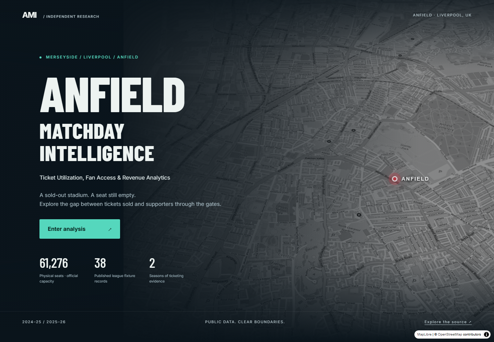
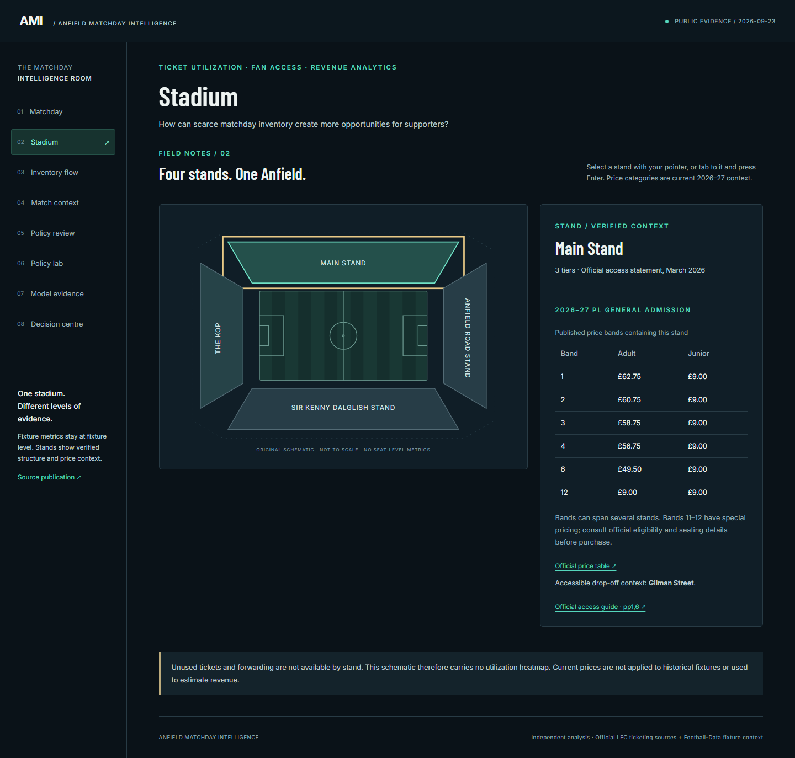
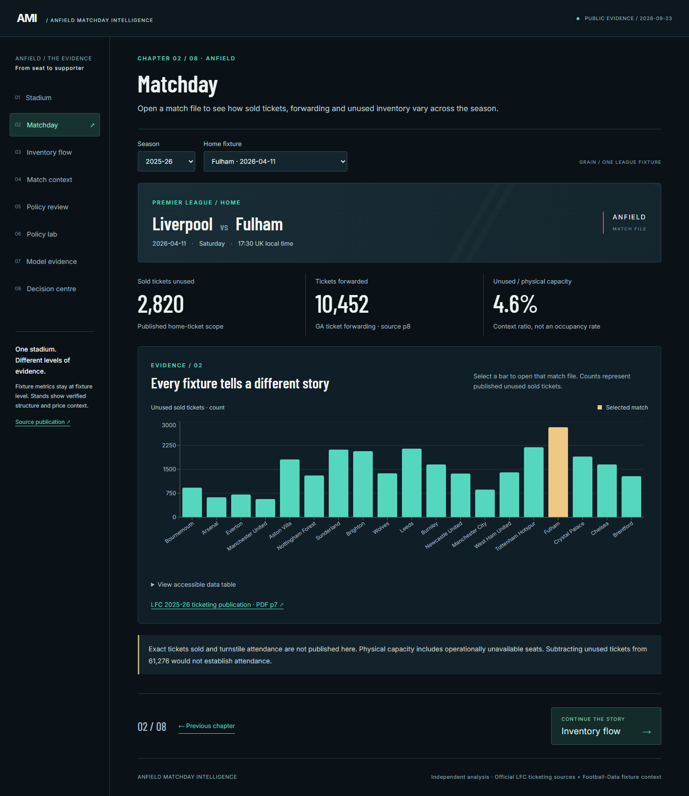
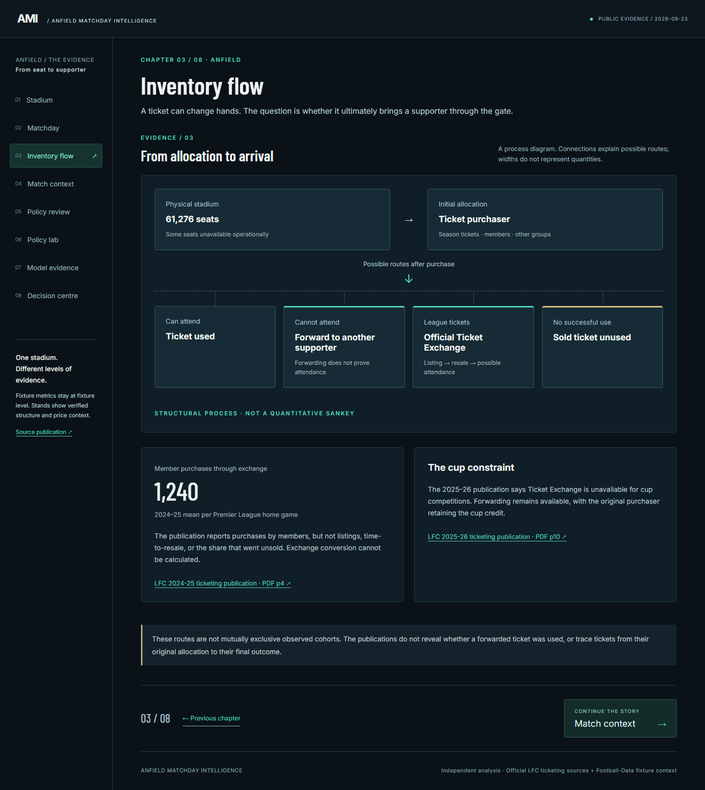
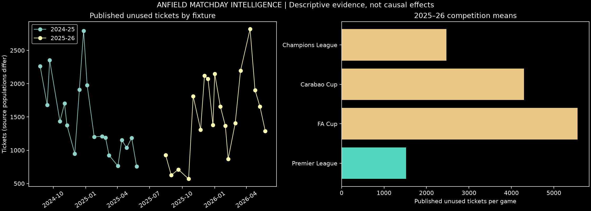
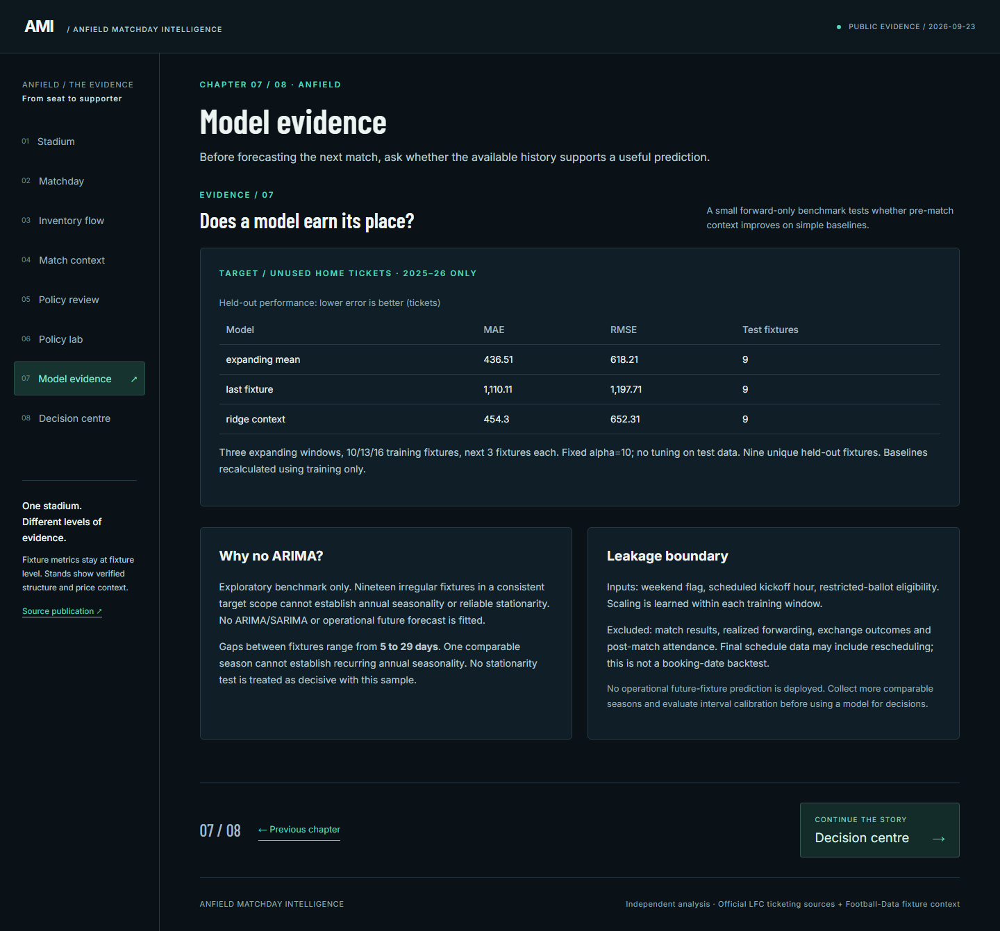
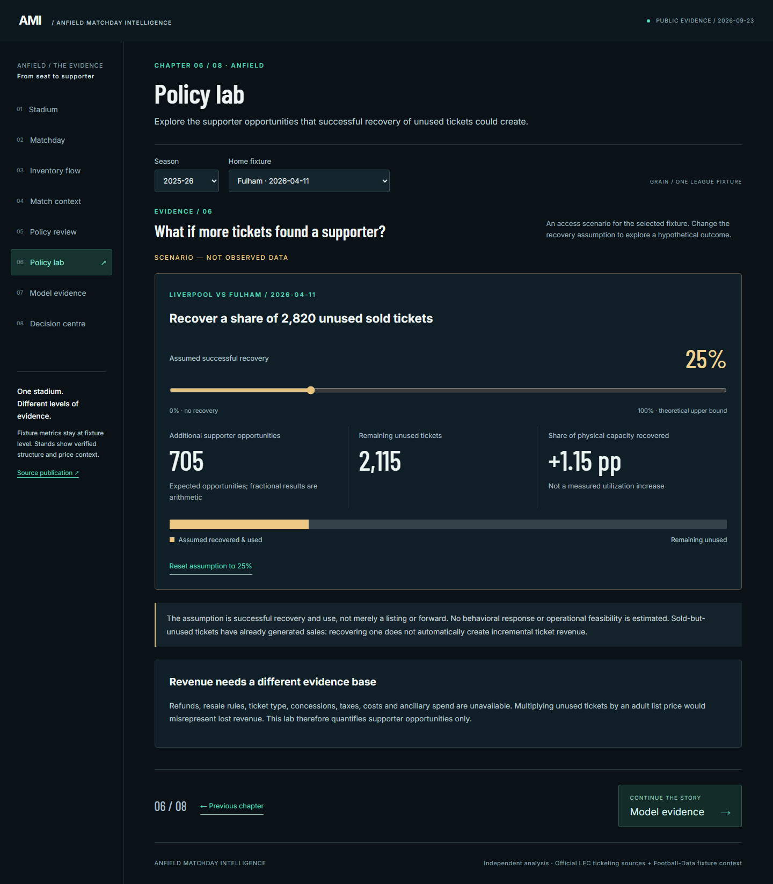

# Anfield Matchday Intelligence

<strong>Ticket utilization · Supporter access · Matchday analytics</strong>

<a href="https://thizisfranklin.github.io/Anfield-Stadium-Ticket-Value-Revenue/"><strong>Explore the live interactive project ↗</strong></a>

**A sold-out stadium. An unused ticket. Someone still trying to get in.**

Liverpool FC plays in one of football's most in-demand stadiums, yet thousands of allocated tickets go unused across a Premier League season. For supporters struggling to secure tickets, this raises an important question: **How can better analysis of ticket utilization, forwarding, and matchday patterns help identify opportunities to improve stadium attendance and supporter access?**

**Anfield Matchday Intelligence** is an independent sports analytics project investigating this question using publicly available Liverpool FC ticketing reports from the **2024–25 and 2025–26 Premier League seasons**.

Using Python, SQL, and statistical analysis, I combined official ticketing records with fixture information to investigate unused tickets, examine redistribution patterns, evaluate forecasting approaches, and model hypothetical ticket-recovery scenarios.

The findings are presented through an interactive React application that connects the analysis with practical questions around matchday operations and supporter access.

## What the Analysis Revealed

The analysis covered **38 Premier League home fixtures across two seasons**, producing four key findings:

- **Unused Ticket Inventory:** Liverpool reported **27,845 unused tickets in 2024–25** and **28,821 in 2025–26**, averaging approximately 1,500 per home match in each season. Differences in reporting definitions prevent a reliable direct comparison between seasons.

- **Ticket Redistribution:** An average of approximately **9,926 tickets were forwarded per Premier League home match in 2025–26**, highlighting the scale of ticket movement between supporters without establishing how many transfers resulted in attendance.

- **Forecasting Performance:** A simple historical-average benchmark achieved an average error of **437 tickets**, slightly outperforming Ridge regression at **454 tickets** across nine held-out fixtures. The results demonstrate that more complex models do not necessarily improve predictions, particularly when historical data is limited.

- **Supporter Access Scenarios:** A hypothetical successful recovery of **25% of the 2,820 unused tickets** recorded for one Fulham fixture would represent **705 additional supporter opportunities**. This illustrates a possible redistribution outcome, not an observed improvement or a validated forecast.

### The Main Takeaway

The analysis highlights an important distinction between **tickets being allocated or transferred and supporters actually entering the stadium**.

Although Liverpool's public reports provide valuable information about unused tickets and forwarding activity, they do not reveal the complete journey of an individual ticket—from allocation through redistribution to actual stadium entry.

**Improving supporter access requires more than predicting unused tickets. It requires understanding whether available tickets can be redistributed in time and successfully used by other supporters.**

The project establishes what can be learned from publicly available ticketing data, evaluates the limitations of current forecasting approaches, and identifies the additional information needed to assess potential improvements in matchday utilization and supporter access.
## New to football (soccer)? Here's the context

Liverpool FC plays in the **Premier League**, England's top football division. Its home, **Anfield**, has a published physical capacity of **61,276 seats**. For many matches, demand is high, but a ticket that was already allocated or sold can still go unused. Supporters who cannot attend may be able to **forward** a ticket to another person or use the club's **Ticket Exchange**. Neither action necessarily tells us whether someone ultimately enters the stadium.

Think of it as an inventory and access problem: unlike online products or airline seats, a matchday seat expires when the match ends. There is no later opportunity to use that exact seat for that exact game.

### A little Liverpool history

Liverpool's story helps explain why so many people care about getting into Anfield. The club's official **Champions Wall** records its major men's trophies, including **20 English league titles**, **6 European Cups/UEFA Champions Leagues**, **8 FA Cups**, and **10 League Cups**. The league title decides England's champion; the European Cup/Champions League decides Europe's top club competition; the FA Cup and League Cup are separate English knockout competitions. <a href="https://www.liverpoolfc.com/history/honours">Full official honours list ↗</a>

 <em>Liverpool FC's Champions Wall, updated after the 2024–25 league title. Photo and further images: <a href="https://www.liverpoolfc.com/news/lfcs-champions-walls-updated-celebrate-20th-league-title">Liverpool FC</a>.</em>

Under **Bill Shankly**, Liverpool rebuilt into an English powerhouse in the 1960s and 1970s. **Bob Paisley's** era delivered sustained domestic and European success. The club's **2005 European Cup comeback in Istanbul** became a defining modern moment; **Jürgen Klopp's** team won Europe in 2019 and the league in 2019–20, before Liverpool captured a **20th league title in 2024–25** under Arne Slot. The history is context, not a variable in the analysis.

### The players behind the atmosphere

These official player portraits help give readers unfamiliar with Liverpool a sense of the people and culture around the club. They are football context only; **player performance isn't part of the dataset**.

<table>
<tr>
<td align="center" width="25%">
 <b>Florian Wirtz</b>
</td>
<td align="center" width="25%">
 <b>Alexander Isak</b>
</td>
<td align="center" width="25%">
 <b>Hugo Ekitike</b>
</td>
<td align="center" width="25%">
 <b>Bradley Barcola</b>
</td>
</tr>
</table>

Liverpool's recent history is also strongly associated with players such as **Mohamed Salah**, who left the club after the 2025–26 season following nine years at Anfield.

<em>Context only: official Liverpool FC-hosted imagery. No player-performance variables enter the project.</em>

## Why I made this

I've supported Liverpool since I was around five. Getting access to tickets is something I connect with personally, so I wanted to investigate what happens *around* the match rather than predict match results.

**My main question:** when ticket demand is constrained, what can public data tell us about unused seats, ticket forwarding and opportunities for more supporters to attend?

## Explore the Interactive Website

The project includes an interactive application that connects the stadium experience with the analytical findings. It allows visitors to explore ticket utilization, fixture information, forecasting evidence, policy questions, and recovery scenarios.

### Arrival and Stadium

Explore Anfield's location, its four stands, and the physical capacity that makes matchday inventory limited.

### Matchday and Ticket Journey

Examine published unused-ticket counts across fixtures and understand how forwarding and ticket exchange relate to supporter access.

The complete website includes **eight interactive sections**, covering match context, policy review, forecasting, scenario modeling, and a decision centre.

[**Explore the complete interactive project ↗**](https://thizisfranklin.github.io/Anfield-Stadium-Ticket-Value-Revenue/)

---

## The Data and What I Investigated

I combined official Liverpool FC ticketing reports with public fixture information, using Python for data extraction, cleaning, and validation, and SQL for querying structured records.

The analysis focused on three connected questions.

### 1. How Does Ticket Utilization Vary Across Matches?

The published reports recorded the following unused-ticket counts:

| Season | Unused tickets | Average per home match |
|---|---:|---:|
| 2024–25 | 27,845 | 1,466 |
| 2025–26 | 28,821 | 1,517 |

These figures provide an indication of unused ticket inventory but cannot establish a reliable season-to-season change because the two reports refer to different ticket populations.

I also compared **16 opponents appearing in both seasons** to investigate whether fixture composition might explain differences.

The average published difference was approximately −1.6 unused tickets per match, with substantial statistical uncertainty. The result does not provide convincing evidence of a change in overall utilization.

Liverpool separately reported a **23% reduction in empty general-admission season-ticket seats** following its *Every Seat, Every Game* initiative. However, this is a club-reported result for a particular ticket category, not an independently established causal effect across the entire stadium.

### 2. Can We Predict Unused Tickets Before Matchday?

To investigate whether match context could improve forecasting, I evaluated three approaches using 19 consistently defined fixtures from the 2025–26 season, including nine later held-out matches.

| Forecasting method | Average error (MAE) |
|---|---:|
| Historical-average benchmark | **437 tickets** |
| Ridge regression | **454 tickets** |
| Previous-fixture benchmark | **1,110 tickets** |

The simplest historical-average approach slightly outperformed Ridge regression.

This illustrates an important finding: **more complex machine learning does not automatically produce better predictions**.

With a limited number of consistently defined fixtures, the current forecasting results should be treated as exploratory rather than deployment-ready.

A larger historical dataset and additional relevant information may help establish whether more sophisticated approaches provide meaningful improvements.

### 3. What Could Ticket Recovery Mean for Supporters?

Forecasting unused tickets is only useful if it can eventually support better decisions.

To explore the potential importance of redistribution, I developed an interactive scenario model.

For one home fixture against Fulham, Liverpool reported **2,820 unused tickets**.

If a hypothetical process successfully recovered and used 25% of those tickets, it would create **705 additional supporter opportunities**, leaving 2,115 tickets unused.

This is an illustrative calculation, not a forecast or a measured outcome.

The scenario highlights why a club might want to understand not only how many tickets go unused, but also how early tickets are returned and whether redistribution results in actual attendance.

---

## What the Findings Mean

The research demonstrates that unused-ticket counts alone cannot fully explain matchday utilization.

A club might know how many tickets were allocated, how many were forwarded, and how many went unused, but those measurements do not necessarily reveal which policies create additional attendance.

Better decision-making would require information about ticket-return timing, successful transfers, and actual stadium entry.

**The main contribution of Anfield Matchday Intelligence is an evidence-based investigation of ticket utilization, forecasting limitations, and the information needed to evaluate potential improvements in supporter access.**

---

## Data Availability and Research Limitations

The project relies entirely on publicly available information rather than Liverpool FC's internal operational systems.

This creates several important limitations:

- **Operational data:** The available reports do not provide complete ticket-level records linking allocation, forwarding, exchange, and stadium entry.
- **Historical consistency:** The two seasons use different ticketing definitions, restricting direct comparisons.
- **Forecasting:** Only 19 consistently defined fixtures were available for the forecasting experiment, limiting conclusions about future predictive performance.
- **Financial outcomes:** Unused tickets cannot automatically be considered lost revenue because many may already have been sold. Detailed financial and behavioral information would be necessary to estimate economic effects.

These limitations are important because they define what the current evidence can establish and what additional information would be necessary for stronger operational conclusions.

Rather than inventing unavailable information, the project identifies the data needed to move from descriptive analysis toward evaluating real improvements.

---

## Future Research and Development

Anfield Matchday Intelligence provides a foundation for several possible extensions.

### Improving Matchday Forecasting

Investigate whether additional historical ticketing records and external variables, such as weather, fixture scheduling, holidays, and transport conditions, improve unused-ticket predictions.

More advanced time-series and machine learning approaches, potentially including LSTM, could be evaluated if sufficient consistently defined data becomes available.

The priority would be reliable forecasting rather than model complexity alone.

### Understanding Ticket Redistribution

With more detailed records, future research could investigate how ticket-return timing, forwarding, and exchange activity influence actual stadium attendance.

It could also examine which reminder or redistribution strategies result in more supporters using available tickets.

### Examining the Wider Matchday Economy

A potential extension is to study the relationship between Liverpool home fixtures and economic activity around Anfield.

This could involve public transport demand, tourism, hospitality, and other local business indicators.

The research would investigate associations between fixtures and surrounding activity without assuming that matchdays—or filling additional seats—automatically cause measurable economic gains.

### Connecting Forecasts to Decisions

A longer-term direction is to combine forecasting estimates, recovery scenarios, and uncertainty into a more comprehensive decision-support framework.

The aim would be to investigate how different ticketing strategies could affect supporter-access outcomes, provided sufficient data becomes available.

**The long-term goal is not simply to predict unused tickets more accurately, but to better understand how data can support decisions that create more opportunities for supporters to attend matches.**

---

## Tools and Reproduction

| Area | Technologies |
|---|---|
| Data analysis | Python, pandas, Jupyter |
| Database querying | SQL, SQLite, PostgreSQL |
| Statistical modeling | scikit-learn, Ridge regression, forecasting baselines |
| Interactive application | React, Vite, Recharts, MapLibre |
| Testing | pytest, Playwright, GitHub Actions |

Supporting documentation:

- [Data Provenance](DATA_PROVENANCE.md)
- [Reproduction Guide](docs/REPRODUCTION.md)
- [Verified Project Claims](VERIFIED_PORTFOLIO_CLAIMS.md)
- [Analysis Notebooks](notebooks)

---

*Anfield Matchday Intelligence is an independent educational project, not affiliated with or endorsed by Liverpool FC. Club photography and imagery are linked from official sources for context. All rights remain with their respective owners.*

**Built with:** Python, pandas, SQL (SQLite and PostgreSQL), scikit-learn, Jupyter, React, Vite, Recharts and MapLibre. Tested using pytest, Playwright and GitHub Actions.

*Independent educational project. Liverpool FC photography and emblem are linked from official club pages for football context; those images are not used in the analysis. All rights remain with their respective owners. Not affiliated with or endorsed by Liverpool FC.*
